# 典型动线走查手册（含截图）

> 体育舞蹈评分系统 · 服务版（FastAPI + Jinja2 + SQLite WAL + SSE）
> 环境：http://59.110.90.21:8321（阿里云测试服务器，正式部署）
> 数据：压测混排赛（8 单位 / 72 名选手对与 8 支集体队 / 9 裁判 / 50 场次 / 27 项目 / 三种评分类型混排）
> 截图目录：`docs/walkthrough/`（本文档所有图片相对引用）
> 生成：2026-08-29，WebUI v1.2（commit bb15474）+ 动线修复（commit 491e091）

---

## 动线总览

| 动线 | 角色 | 步数 | 覆盖 FR |
|------|------|------|---------|
| [观众动线](#观众动线3-步) | 公开（免登录） | 3 | FR-F1/E5/I7 |
| [裁判动线](#裁判动线5-步) | 裁判（移动优先） | 5 | FR-C1~C5/H2 |
| [管理员动线](#管理员动线10-步) | 管理员（桌面优先） | 10 | FR-A/B/C/D/E/G/I |

---

## 观众动线（3 步）

免登录。入口：任意浏览器打开 `http://59.110.90.21:8321/`——未登录访客自动落到公开赛程页
（观众首屏不再见登录墙，2026-08-29 动线修复）。

### 第 1 步：看赛程

`/public/schedule` —— 全部场次按编号排列，状态徽章：已发布 / 已计算 / 评分中 / 待赛。
顶部导航可跳「成绩 / 团体总分 / 大屏」。

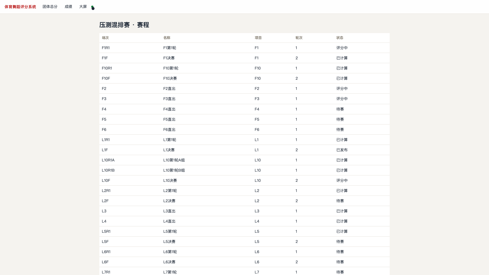

**验证点**：状态实时（SSE 自动刷新）；评分中场次显示「评分中」。

### 第 2 步：看成绩

`/public/results` —— 顶部为**团体总分榜**（名次赋分口径 + 各项目得分分解），
下方为已发布场次的最终名次表。

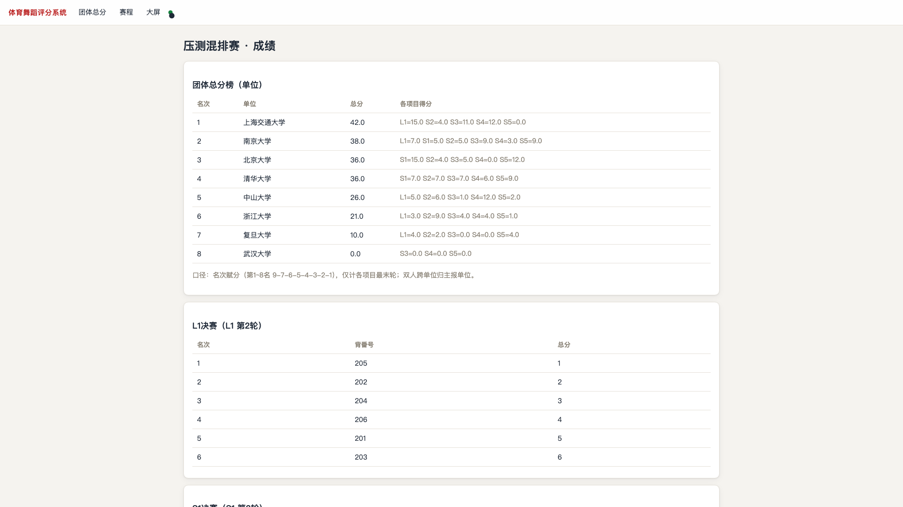

**验证点**：只显示已发布场次（D5 发布制）；口径说明可见（仅计最末轮、跨单位归主报单位）。

### 第 3 步：看团体总分榜 / 大屏

`/public/team-standings` —— 独立总分页，SSE 自动刷新。

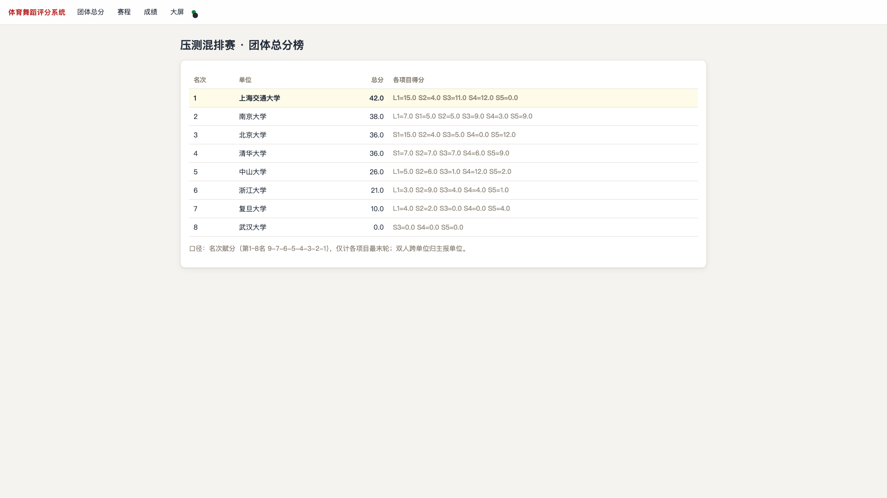

大屏 `/screen` —— 自动轮播（评分进行中 → 成绩公告 → 团体总分榜 → 欢迎页），
管理员可在大屏控制页强制指定画面。

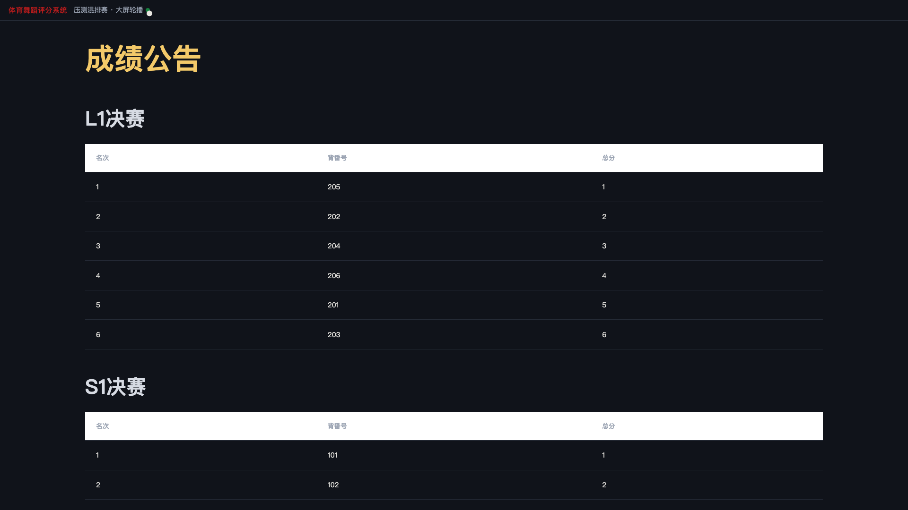

---

## 裁判动线（5 步）

移动优先（手机竖屏触控）。推荐裁判手机书签直达：
**`/login?role=judge&judge=J1`** —— 自动切到裁判角色并预填裁判 ID（易用性改进，免手动切下拉）。

### 第 1 步：直达登录

**验证点**：角色已自动切「裁判」、ID 已预填；点「登录」即进工作台。

### 第 2 步：看待评场次

`/judge` —— 当前所有「评分中」场次卡片；已提交过的舞种带 ✓ 标记。
SSE 实时：管理员开场/关场/退回评分时页面自动刷新。

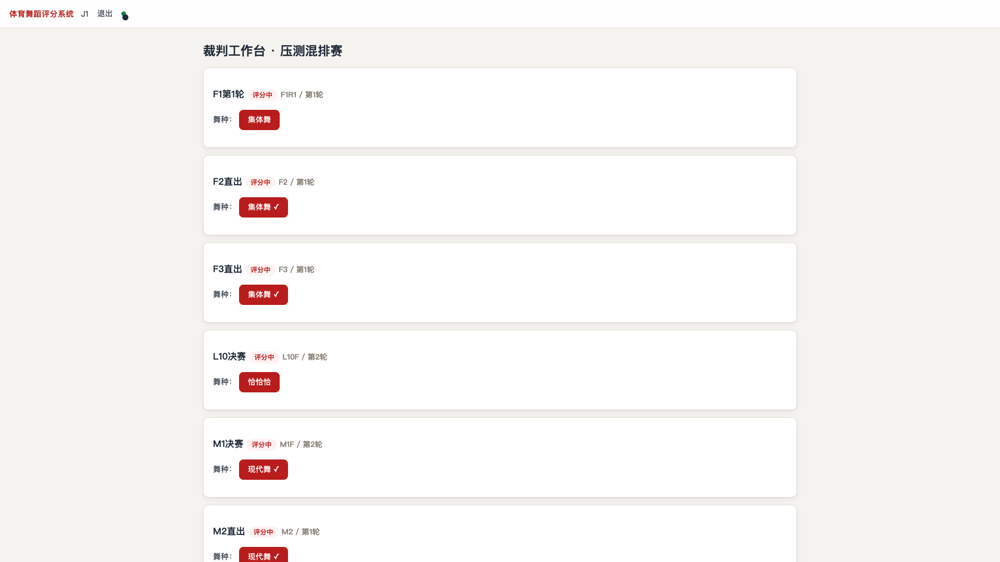

### 第 3 步：打开评分表（评分制场次示例）

点舞种链接进入评分表。评分制场次显示 **0~10 分值输入框**（一位小数）。

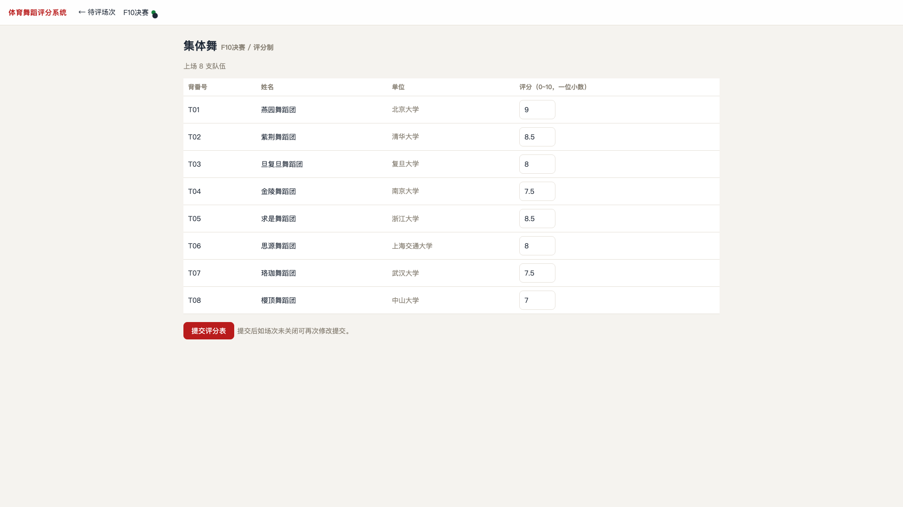

**验证点**：表头标注「评分（0~10，一位小数）」；已提交的分值回显。

### 第 4 步：打开评分表（顺位法场次示例）

顺位法场次显示**名次下拉**（1~N 互斥）；Mark 制场次显示布尔勾选框。
姓名列显示双人姓名（跨单位双人标注双方单位）。

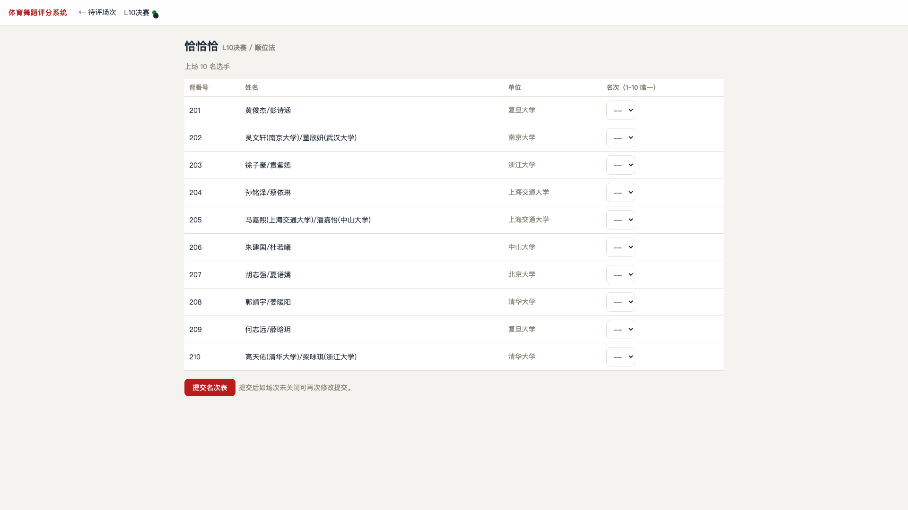

**验证点**：三种评分类型的表单形态正确区分；提交按钮文案随类型变化
（提交名次表 / 提交标记表 / 提交评分表）。

### 第 5 步：提交与确认

点提交后显示「已提交，等待其他裁判」或「已提交（全员收齐，已自动计算）」；
裁判工作台对应舞种出现 ✓；全员收齐后场次自动计算并关闭（再次提交会提示「场次已关闭评分」）。

---

## 管理员动线（10 步）

桌面优先。登录口令 `admin123`（生产环境用 `DSPORT_ADMIN_PASSWORD` 覆盖）。

### 第 1 步：登录

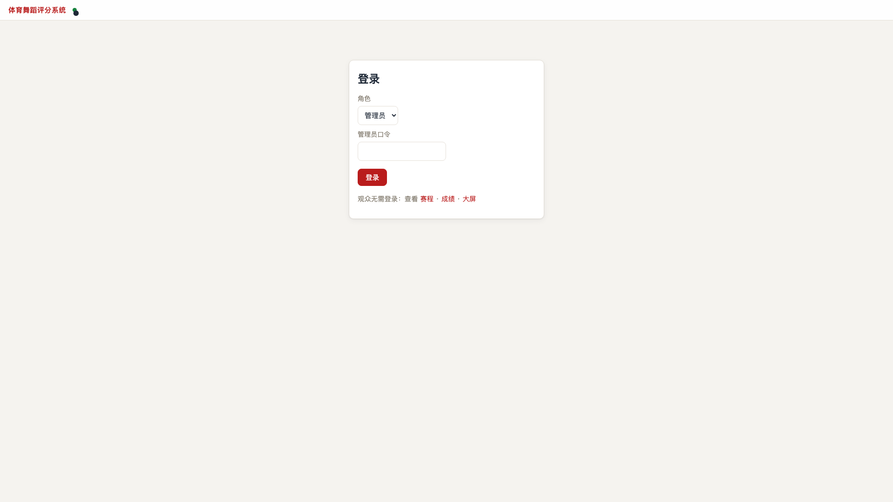

### 第 2 步：创建赛事（FR-A1）

`/events` —— 创建表单 + 赛事列表。创建后点「激活」；
**激活语义（Q6）**：同一时间仅一个赛事处于运行流程，新激活自动停用旧赛事。

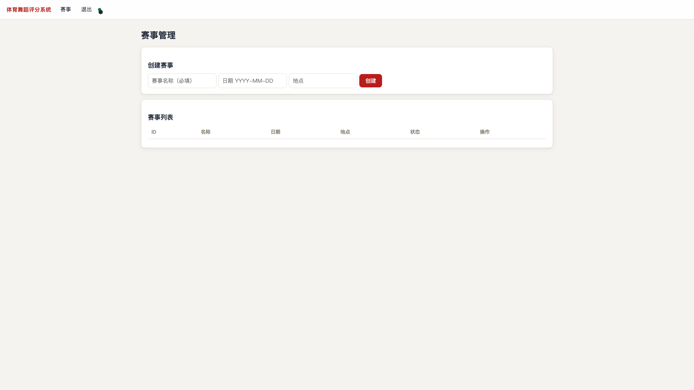

### 第 3 步：数据导入（FR-B）

`/events/{eid}/import` —— 三段 CSV 上传（选手 / 裁判 / 赛程），
导入后显示条数与**校验报告**（problems 逐条展示）。
集体队伍以 T 编号作为选手行导入（FR-I1）。

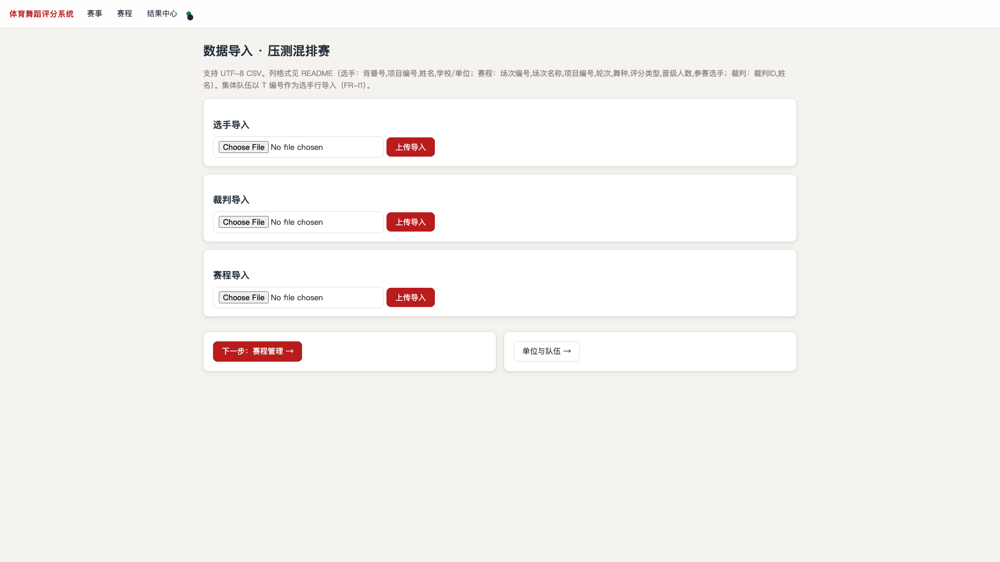

### 第 4 步：赛程编排（FR-C1/J2）

`/events/{eid}/schedule` —— **项目树总览**：项目卡 → 轮次分组（已完成/进行中徽章）→
场次行（四色状态标签）。支持：

- **添加场次**（表单：编号/名称/项目/轮次/多舞种/评分类型/晋级人数/首轮名单）
- **编辑**（仅未开场场次；code 锁定）
- **删除**（仅未开场场次）
- **大项目分组**（>40 对同项目同轮多场次，如 S10R1A/B/C，晋级确认自动合并各组预案）

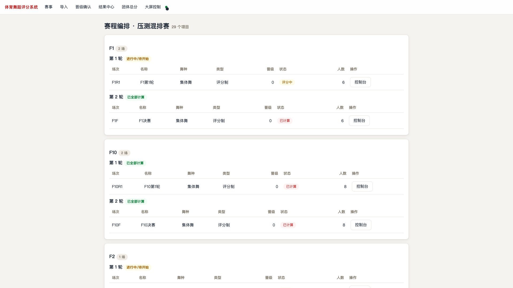

### 第 5 步：场次控制台——开场（FR-C5/G3）

点场次「控制台」进入。勾选上场选手 → 点「开启评分」→ 状态 pending → scoring，
SSE 推送裁判端立即出现该场次。

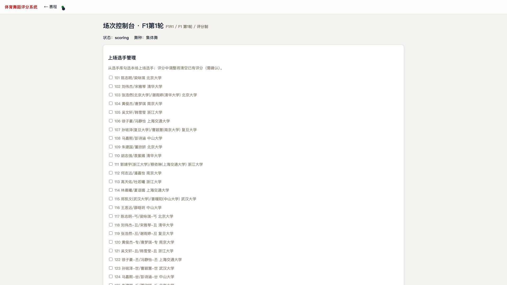

### 第 6 步：监控评分进度（FR-H3）

控制台裁判进度矩阵实时更新（每裁判 × 每舞种 n/N）；裁判端提交即时可见。

### 第 7 步：计算与退回（FR-D1/G5）

- 收齐自动计算（状态 → calculated），或点「手动计算/重算」
- 「退回评分」：清空本场评分与结果回到评分中（危险操作二次确认），
  裁判端页面即时收到 score_returned 事件刷新

### 第 8 步：晋级确认（FR-D3~D6/G7）

`/events/{eid}/advancement?project=X&round=N` ——
合并同项目同轮全部场次（含分组 A/B/C）的晋级者，按总分排序生成预案；
**可编辑勾选**晋级名单（默认预勾前 N），确认后按名次蛇形分配回填下一轮。

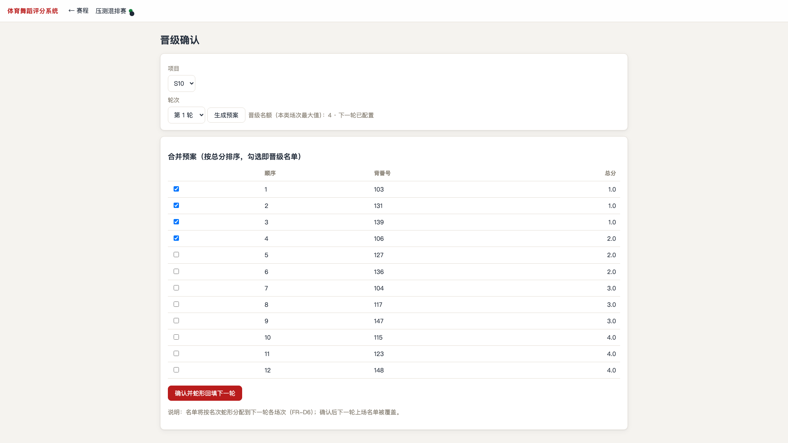

**验证点**（S10 大项目分组场景）：三组合并预案排序正确；预勾数量=晋级名额；回填后下一轮人数正确。

### 第 9 步：结果中心与发布（FR-E1~E4/G8/G10）

`/events/{eid}/results` —— 全部已计算场次的结果表（综合+分舞种）、
发布/撤回/重算逐场操作、Markdown 与打印 HTML 导出、数据库备份、
**评分明细**（FR-E4：每裁判×每选手原始打分，仅本页可见）。

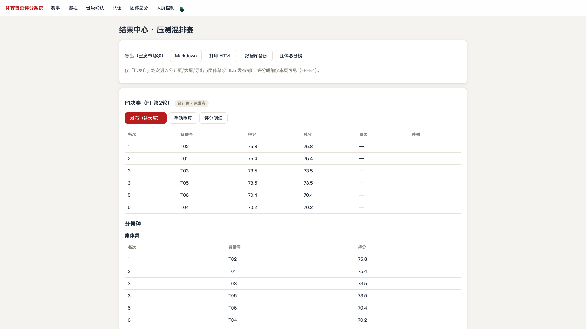

### 第 10 步：团体总分与大屏控制（FR-I6~I8/G9/D4）

`/events/{eid}/team-standings` —— 管理口径（全部已计算场次），
**每单位每项目计入条数**可即时切换（全部 / 最佳 1/2/3 项，口径参数化 D12）。

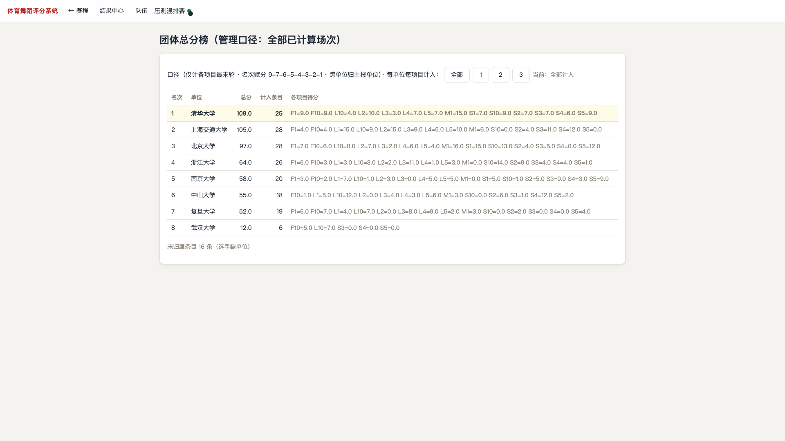

`/events/{eid}/screen-control` —— 强制指定大屏画面（自动轮播 / 评分进行中 /
成绩公告 / 团体总分榜 / 欢迎页），SSE 推送大屏即时生效（v1 为内存态，重启归自动）。

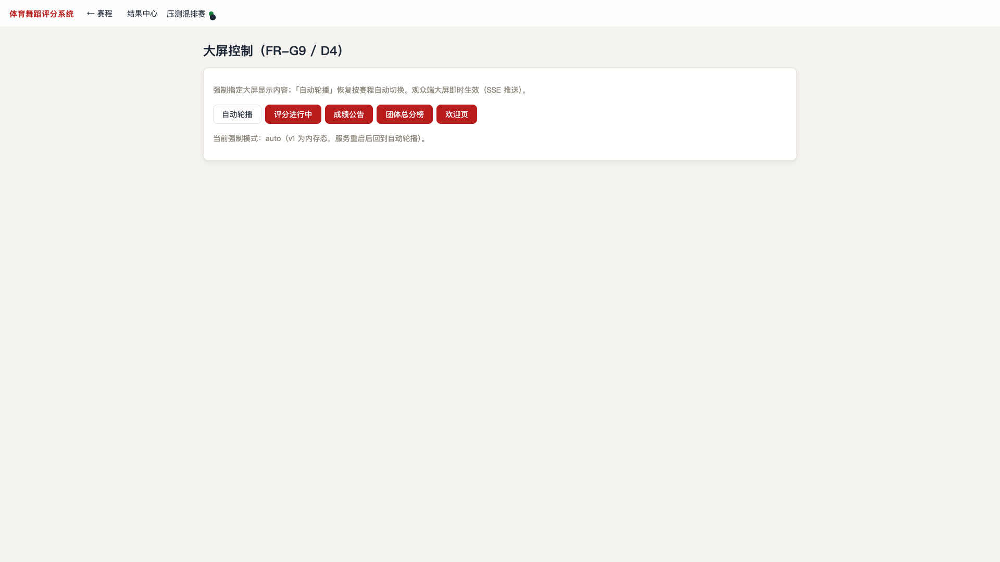

---

## 附录 A：公开口访问地址速查

| 页面 | 地址 | 登录 |
|------|------|------|
| 根入口 | `/` | 按角色跳转；未登录 → 公开赛程 |
| 公开赛程 | `/public/schedule` | 免登录 |
| 公开成绩 | `/public/results` | 免登录 |
| 公开团体总分 | `/public/team-standings` | 免登录 |
| 大屏 | `/screen` | 免登录 |
| 裁判直达登录 | `/login?role=judge&judge=J1` | 预填裁判 ID |
| 管理登录 | `/login` | 口令 admin123（生产须覆盖） |

## 附录 B：评分类型与表单形态

| 类型 | CSV 标记 | 表单形态 | 计算规则 |
|------|----------|----------|----------|
| 顺位法 | SKATING | 名次下拉（1~N 互斥） | Skating 多数决（core） |
| Mark制 | MARK | 布尔勾选（通过=✓） | 标记票计数（core，D11 布尔语义） |
| 评分制 | SCORE | 0~10 数值（一位小数） | 全裁判求和降序排名（M6 新增，同分并列） |

## 附录 C：走查中发现并已修复的问题（2026-08-29）

1. 未登录访客首屏为登录墙 → 根路径改跳公开赛程
2. 公开页导航缺团体总分入口 → 已补
3. 裁判登录需手动切角色下拉 → URL 参数直达（role/judge）
4. 评分制场次评分表被渲染成名次下拉（路由分支 bug）→ 改 scoring_kind 三态判断
5. （结构）base.html scripts 未包裹 `<script>` 标签致新页面 JS 失效 → 已统一修复
