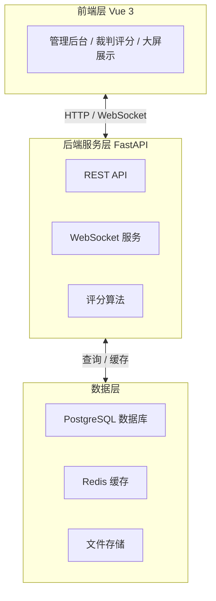
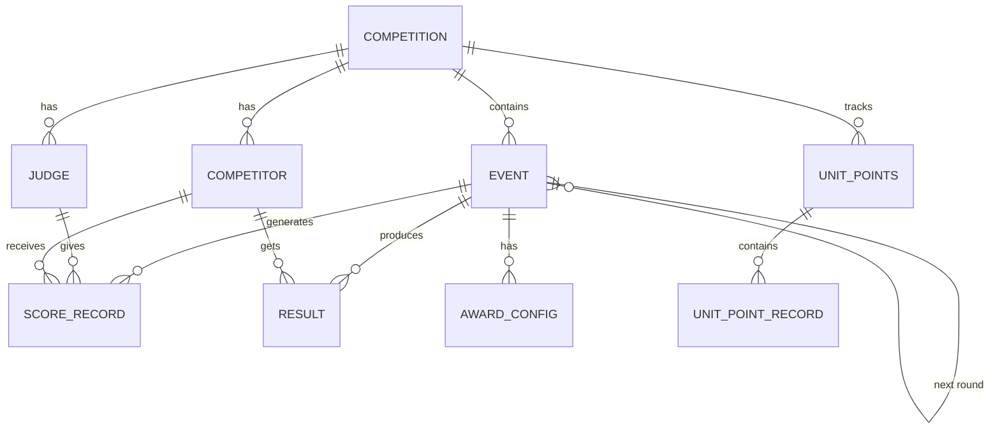

# 体育舞蹈赛事评分系统 Web 版 - 技术架构

## 1. 架构设计



---

## 2. 技术选型

| 层级 | 技术方案 | 说明 |
|------|----------|------|
| **前端框架** | Vue 3 + Composition API | 响应式、Composition API、TypeScript |
| **UI组件库** | Element Plus | 成熟的Vue3组件库，响应式支持好 |
| **状态管理** | Pinia | Vue3官方推荐，轻量级 |
| **路由管理** | Vue Router 4 | SPA路由 |
| **HTTP客户端** | Axios | 请求拦截、统一错误处理 |
| **实时通信** | Socket.io | WebSocket降级支持 |
| **后端框架** | FastAPI | 异步、高性能、自动API文档 |
| **ORM** | SQLAlchemy 2.0 | 类型安全、异步支持 |
| **数据库** | PostgreSQL | JSON类型、复杂查询支持 |
| **缓存** | Redis | 实时数据、会话存储 |
| **数据迁移** | Alembic | 数据库版本管理 |
| **部署** | Docker Compose | 一键部署 |

---

## 3. 目录结构

```
web/
├── backend/                          # 后端项目
│   ├── app/
│   │   ├── api/                       # API路由
│   │   │   ├── v1/
│   │   │   │   ├── competitions.py   # 赛事API
│   │   │   │   ├── events.py          # 场次API
│   │   │   │   ├── competitors.py     # 选手API
│   │   │   │   ├── scoring.py         # 评分API
│   │   │   │   ├── results.py         # 成绩API
│   │   │   │   └── ranking.py         # 排名API
│   │   │   ├── auth.py                # 认证API
│   │   │   └── export.py              # 导出API
│   │   ├── core/                      # 核心配置
│   │   │   ├── config.py              # 应用配置
│   │   │   ├── database.py            # 数据库连接
│   │   │   ├── security.py            # 安全认证
│   │   │   └── websocket.py           # WebSocket管理
│   │   ├── models/                    # 数据模型
│   │   │   ├── competition.py
│   │   │   ├── event.py
│   │   │   ├── competitor.py
│   │   │   ├── judge.py
│   │   │   ├── score.py
│   │   │   ├── result.py
│   │   │   └── unit_points.py
│   │   ├── schemas/                   # Pydantic模型
│   │   │   ├── competition.py
│   │   │   ├── event.py
│   │   │   ├── competitor.py
│   │   │   ├── scoring.py
│   │   │   └── ranking.py
│   │   ├── services/                  # 业务逻辑
│   │   │   ├── scoring_service.py
│   │   │   ├── ranking_service.py
│   │   │   └── export_service.py
│   │   └── main.py                   # 应用入口
│   ├── requirements.txt
│   ├── Dockerfile
│   └── alembic/                       # 数据库迁移
│
├── frontend/                          # 前端项目
│   ├── src/
│   │   ├── api/                       # API封装
│   │   │   ├── index.ts
│   │   │   ├── competitions.ts
│   │   │   ├── events.ts
│   │   │   ├── scoring.ts
│   │   │   └── ranking.ts
│   │   ├── assets/
│   │   │   └── styles/
│   │   │       ├── variables.scss
│   │   │       └── main.scss
│   │   ├── components/                 # 公共组件
│   │   │   ├── common/
│   │   │   ├── scoring/
│   │   │   └── display/
│   │   ├── composables/               # 组合式函数
│   │   │   ├── useScoring.ts
│   │   │   ├── useWebSocket.ts
│   │   │   └── useResponsive.ts
│   │   ├── router/
│   │   │   └── index.ts
│   │   ├── store/                     # Pinia状态
│   │   │   ├── competition.ts
│   │   │   ├── scoring.ts
│   │   │   └── ranking.ts
│   │   ├── utils/
│   │   │   ├── request.ts
│   │   │   ├── storage.ts
│   │   │   └── device.ts
│   │   ├── views/                     # 页面
│   │   │   ├── Login.vue
│   │   │   ├── Dashboard.vue
│   │   │   ├── competitions/
│   │   │   ├── events/
│   │   │   ├── scoring/
│   │   │   ├── results/
│   │   │   ├── ranking/
│   │   │   └── display/
│   │   ├── App.vue
│   │   └── main.ts
│   ├── public/
│   ├── index.html
│   ├── vite.config.ts
│   ├── tsconfig.json
│   └── package.json
│
├── docker-compose.yml
└── README.md
```

---

## 4. API路由定义

### 4.1 基础路由

| 方法 | 路由 | 说明 |
|------|------|------|
| POST | /api/v1/auth/login | 用户登录 |
| POST | /api/v1/auth/logout | 用户登出 |
| GET | /api/v1/auth/me | 获取当前用户 |

### 4.2 赛事管理

| 方法 | 路由 | 说明 |
|------|------|------|
| GET | /api/v1/competitions | 获取赛事列表 |
| POST | /api/v1/competitions | 创建赛事 |
| GET | /api/v1/competitions/:id | 获取赛事详情 |
| PUT | /api/v1/competitions/:id | 更新赛事 |
| DELETE | /api/v1/competitions/:id | 删除赛事 |
| POST | /api/v1/competitions/:id/start | 开始赛事 |
| POST | /api/v1/competitions/:id/finish | 结束赛事 |

### 4.3 选手管理

| 方法 | 路由 | 说明 |
|------|------|------|
| GET | /api/v1/competitions/:comp_id/competitors | 获取选手列表 |
| POST | /api/v1/competitions/:comp_id/competitors | 添加选手 |
| POST | /api/v1/competitions/:comp_id/competitors/import | 批量导入 |
| PUT | /api/v1/competitions/:comp_id/competitors/:id | 更新选手 |
| DELETE | /api/v1/competitions/:comp_id/competitors/:id | 删除选手 |

### 4.4 场次管理

| 方法 | 路由 | 说明 |
|------|------|------|
| GET | /api/v1/competitions/:comp_id/events | 获取场次列表 |
| POST | /api/v1/competitions/:comp_id/events | 创建场次 |
| GET | /api/v1/events/:id | 获取场次详情 |
| PUT | /api/v1/events/:id | 更新场次 |
| DELETE | /api/v1/events/:id | 删除场次 |
| POST | /api/v1/events/:id/start | 开始评分 |
| POST | /api/v1/events/:id/complete | 完成评分 |

### 4.5 评分

| 方法 | 路由 | 说明 |
|------|------|------|
| GET | /api/v1/events/:id/scores | 获取评分数据 |
| POST | /api/v1/events/:id/scores | 提交评分 |
| PUT | /api/v1/events/:id/scores/:judge_id | 更新评分 |

### 4.6 成绩

| 方法 | 路由 | 说明 |
|------|------|------|
| GET | /api/v1/events/:id/results | 获取成绩 |
| GET | /api/v1/events/:id/results/dance/:dance | 分舞种成绩 |

### 4.7 单位总分

| 方法 | 路由 | 说明 |
|------|------|------|
| GET | /api/v1/competitions/:comp_id/ranking | 获取总分排名 |
| GET | /api/v1/competitions/:comp_id/ranking/:unit | 单位得分明细 |
| GET | /api/v1/events/:id/award-config | 获取奖项配置 |
| PUT | /api/v1/events/:id/award-config | 更新奖项配置 |

### 4.8 导出

| 方法 | 路由 | 说明 |
|------|------|------|
| POST | /api/v1/events/:id/export/pdf | 导出PDF |
| POST | /api/v1/events/:id/export/excel | 导出Excel |
| GET | /api/v1/export/:job_id | 下载导出文件 |

---

## 5. 数据模型

### 5.1 ER图



### 5.2 表结构定义

```sql
-- 赛事表
CREATE TABLE competitions (
    id UUID PRIMARY KEY DEFAULT gen_random_uuid(),
    name VARCHAR(200) NOT NULL,
    date DATE NOT NULL,
    location VARCHAR(200),
    status VARCHAR(50) DEFAULT 'draft',
    created_at TIMESTAMP DEFAULT CURRENT_TIMESTAMP,
    updated_at TIMESTAMP DEFAULT CURRENT_TIMESTAMP
);

-- 场次表
CREATE TABLE events (
    id UUID PRIMARY KEY DEFAULT gen_random_uuid(),
    competition_id UUID REFERENCES competitions(id) ON DELETE CASCADE,
    name VARCHAR(200) NOT NULL,
    project_id VARCHAR(50),
    round VARCHAR(50),
    scoring_type VARCHAR(50) NOT NULL CHECK (scoring_type IN ('mark', 'skating')),
    dances JSONB DEFAULT '[]',
    advancement_count INTEGER DEFAULT 0,
    status VARCHAR(50) DEFAULT 'pending',
    parent_event_id UUID REFERENCES events(id),
    child_event_id UUID REFERENCES events(id),
    created_at TIMESTAMP DEFAULT CURRENT_TIMESTAMP
);

-- 选手表
CREATE TABLE competitors (
    id UUID PRIMARY KEY DEFAULT gen_random_uuid(),
    competition_id UUID REFERENCES competitions(id) ON DELETE CASCADE,
    number VARCHAR(50) NOT NULL,
    name VARCHAR(100) NOT NULL,
    unit VARCHAR(200),
    unit_code VARCHAR(50),
    group_name VARCHAR(100),
    partner_number VARCHAR(50),
    partner_unit VARCHAR(200),
    is_couple BOOLEAN DEFAULT FALSE,
    created_at TIMESTAMP DEFAULT CURRENT_TIMESTAMP,
    UNIQUE(competition_id, number)
);

-- 裁判表
CREATE TABLE judges (
    id UUID PRIMARY KEY DEFAULT gen_random_uuid(),
    competition_id UUID REFERENCES competitions(id) ON DELETE CASCADE,
    name VARCHAR(100),
    position VARCHAR(50),
    created_at TIMESTAMP DEFAULT CURRENT_TIMESTAMP
);

-- 评分记录表
CREATE TABLE score_records (
    id UUID PRIMARY KEY DEFAULT gen_random_uuid(),
    event_id UUID REFERENCES events(id) ON DELETE CASCADE,
    judge_id UUID REFERENCES judges(id) ON DELETE CASCADE,
    competitor_number VARCHAR(50) NOT NULL,
    dance_name VARCHAR(100),
    score FLOAT,
    mark BOOLEAN,
    placement INTEGER,
    created_at TIMESTAMP DEFAULT CURRENT_TIMESTAMP,
    updated_at TIMESTAMP DEFAULT CURRENT_TIMESTAMP
);

-- 比赛结果表
CREATE TABLE results (
    id UUID PRIMARY KEY DEFAULT gen_random_uuid(),
    event_id UUID REFERENCES events(id) ON DELETE CASCADE,
    competitor_number VARCHAR(50) NOT NULL,
    competitor_name VARCHAR(100),
    unit VARCHAR(200),
    rank INTEGER,
    score FLOAT,
    total_score FLOAT,
    dance_name VARCHAR(100),
    created_at TIMESTAMP DEFAULT CURRENT_TIMESTAMP
);

-- 奖项得分配置表
CREATE TABLE award_configs (
    id UUID PRIMARY KEY DEFAULT gen_random_uuid(),
    event_id UUID REFERENCES events(id) ON DELETE CASCADE UNIQUE,
    points JSONB NOT NULL,
    created_at TIMESTAMP DEFAULT CURRENT_TIMESTAMP,
    updated_at TIMESTAMP DEFAULT CURRENT_TIMESTAMP
);

-- 单位总分表
CREATE TABLE unit_points (
    id UUID PRIMARY KEY DEFAULT gen_random_uuid(),
    competition_id UUID REFERENCES competitions(id) ON DELETE CASCADE,
    unit VARCHAR(200) NOT NULL,
    total_points FLOAT DEFAULT 0,
    record_count INTEGER DEFAULT 0,
    updated_at TIMESTAMP DEFAULT CURRENT_TIMESTAMP,
    UNIQUE(competition_id, unit)
);

-- 单位得分明细表
CREATE TABLE unit_point_records (
    id UUID PRIMARY KEY DEFAULT gen_random_uuid(),
    unit_points_id UUID REFERENCES unit_points(id) ON DELETE CASCADE,
    event_id UUID REFERENCES events(id) ON DELETE CASCADE,
    event_name VARCHAR(200),
    competitor_number VARCHAR(50),
    competitor_name VARCHAR(100),
    rank INTEGER,
    points FLOAT,
    is_split BOOLEAN DEFAULT FALSE,
    created_at TIMESTAMP DEFAULT CURRENT_TIMESTAMP
);

-- 用户表
CREATE TABLE users (
    id UUID PRIMARY KEY DEFAULT gen_random_uuid(),
    username VARCHAR(100) UNIQUE NOT NULL,
    password_hash VARCHAR(255) NOT NULL,
    role VARCHAR(50) DEFAULT 'admin',
    created_at TIMESTAMP DEFAULT CURRENT_TIMESTAMP
);

-- 索引
CREATE INDEX idx_events_competition ON events(competition_id);
CREATE INDEX idx_competitors_competition ON competitors(competition_id);
CREATE INDEX idx_score_records_event ON score_records(event_id);
CREATE INDEX idx_results_event ON results(event_id);
CREATE INDEX idx_unit_points_competition ON unit_points(competition_id);
```

---

## 6. WebSocket事件

| 事件名 | 方向 | 说明 |
|--------|------|------|
| connect | Client→Server | 建立连接 |
| disconnect | Client/Server | 断开连接 |
| score:submitted | Server→Client | 评分已提交 |
| score:updated | Server→Client | 评分已更新 |
| event:completed | Server→Client | 场次完成 |
| ranking:updated | Server→Client | 排名已更新 |

---

## 7. 响应式布局

### 7.1 CSS断点

```scss
// 响应式断点
$breakpoints: (
  'xs': 0px,
  'sm': 576px,
  'md': 768px,
  'lg': 992px,
  'xl': 1200px,
  'xxl': 1400px
);

// 设备类型
$devices: (
  'mobile': max-width: 767px,
  'tablet': 768px to 991px,
  'desktop': min-width: 992px
);
```

### 7.2 布局策略

| 设备 | 导航方式 | 内容布局 | 评分界面 |
|------|----------|----------|----------|
| 手机 | 底部Tab | 单列卡片 | 全屏触控 |
| 平板竖屏 | 底部Tab | 单列列表 | 大按钮 |
| 平板横屏 | 侧边栏 | 双列布局 | 分栏布局 |
| 桌面 | 侧边栏 | 多列布局 | 完整表格 |

---

## 8. 部署架构

```yaml
# docker-compose.yml
version: '3.8'

services:
  frontend:
    build: ./frontend
    ports:
      - "80:80"
    depends_on:
      - backend
    networks:
      - internal

  backend:
    build: ./backend
    ports:
      - "8000:8000"
    environment:
      - DATABASE_URL=postgresql://postgres:password@db:5432/dancesport
      - REDIS_URL=redis://cache:6379
    depends_on:
      - db
      - cache
    networks:
      - internal

  db:
    image: postgres:15-alpine
    environment:
      - POSTGRES_DB=dancesport
      - POSTGRES_PASSWORD=password
    volumes:
      - postgres_data:/var/lib/postgresql/data
    networks:
      - internal

  cache:
    image: redis:7-alpine
    networks:
      - internal

networks:
  internal:
    driver: bridge

volumes:
  postgres_data:
```
