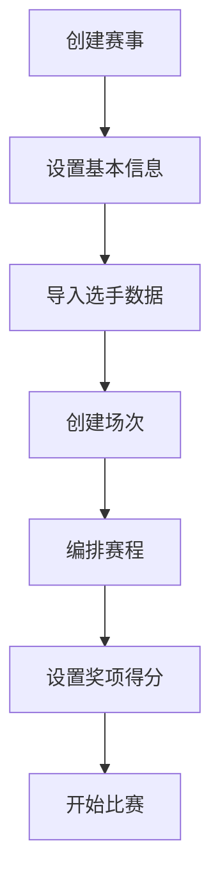
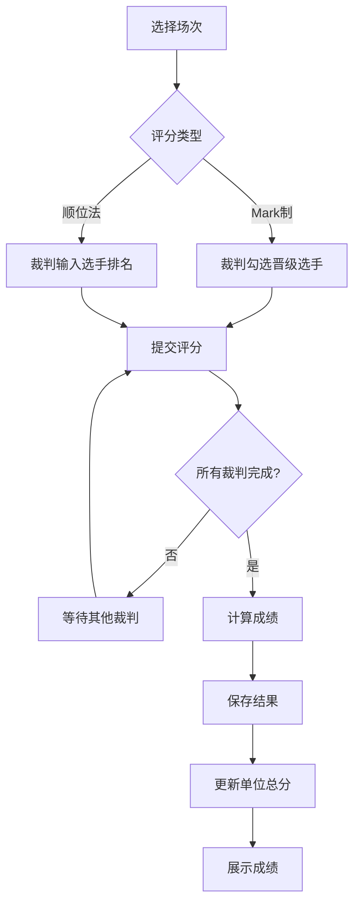
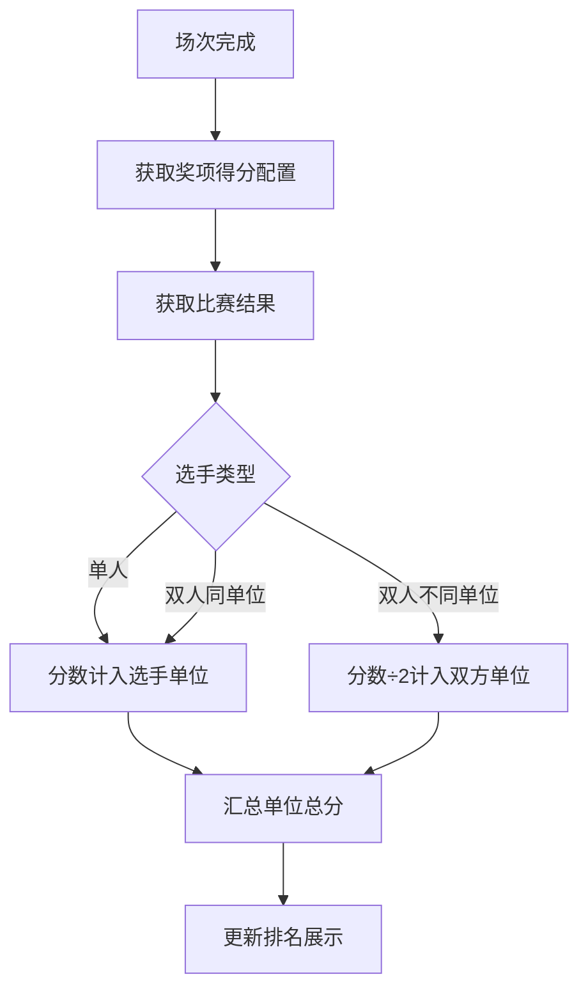

# 体育舞蹈赛事评分系统 Web 版

## 1. 产品概述

体育舞蹈赛事评分系统Web版是专为体育舞蹈比赛设计的在线评分管理平台，支持局域网内部署，适配PC、平板、手机等多种设备。系统提供赛事管理、场次编排、实时评分、成绩展示、单位总分统计和导出功能，适用于学校体育舞蹈比赛、地区性体育舞蹈赛事等场景。

**核心价值：**
- 多设备统一访问：一部平板即可完成裁判评分
- 实时成绩展示：大屏同步显示比赛结果
- 数据集中管理：所有评分数据实时同步
- 灵活导出：支持PDF、Excel等多种格式

---

## 2. 功能模块

### 2.1 用户角色

| 角色 | 说明 | 核心权限 |
|------|------|----------|
| 管理员 | 赛事组织者 | 赛事管理、场次编排、评分监控、导出报表 |
| 裁判 | 现场评分人员 | 参与评分、查看本人评分记录 |
| 展示端 | 大屏/观众 | 查看实时成绩排名 |

### 2.2 功能模块

1. **首页/赛事概览**
   - 当前赛事基本信息展示
   - 快速入口：进行中的场次、最近完成场次
   - 单位总分排名实时预览

2. **赛事管理**
   - 创建/编辑/删除赛事
   - 赛事基本信息（名称、日期、地点）
   - 参赛单位管理
   - 赛事状态控制（草稿/进行中/已完成）

3. **选手管理**
   - 批量导入选手（Excel/CSV）
   - 编辑选手信息（番号、姓名、单位、组别）
   - 双人项目搭档设置
   - 选手分组管理

4. **场次管理**
   - 创建/编辑场次
   - 设置评分类型（Mark制/顺位法）
   - 配置舞种列表
   - 设置晋级规则和人数
   - 场次状态管理（待评分/评分中/已完成）

5. **评分系统**
   - 裁判评分界面（平板优化）
   - 背番号勾选/排名输入
   - 多舞种切换
   - 评分提交与修改
   - 评分数据实时保存

6. **成绩管理**
   - 场次成绩查看
   - 分舞种成绩展示
   - 综合成绩排名
   - 晋级确认与下一轮编排

7. **单位总分**
   - 设置各场次录取名次得分
   - 实时计算各单位总分
   - 总分排名展示
   - 得分明细查询
   - 双人项目得分分摊

8. **导出功能**
   - PDF成绩单导出
   - Excel数据导出
   - Markdown格式导出
   - 批量导出

9. **大屏展示**
   - 实时成绩大屏
   - 单位总分排名大屏
   - 赛场信息展示

---

## 3. 核心流程

### 3.1 赛事创建流程

### 3.2 评分流程

### 3.3 单位总分计算流程

---

## 4. 页面清单

| 页面名称 | 路由 | 功能描述 |
|----------|------|----------|
| 登录页 | /login | 用户登录认证 |
| 首页 | / | 赛事概览、快速入口 |
| 赛事管理 | /competitions | 赛事列表、创建赛事 |
| 赛事详情 | /competitions/:id | 赛事详情、编辑 |
| 选手管理 | /competitions/:id/competitors | 选手列表、导入导出 |
| 场次管理 | /competitions/:id/events | 场次列表、创建编辑 |
| 评分页面 | /competitions/:id/scoring/:eventId | 裁判评分界面 |
| 成绩查看 | /competitions/:id/results | 成绩列表、明细 |
| 单位总分 | /competitions/:id/ranking | 单位总分排名 |
| 奖项配置 | /competitions/:id/awards | 名次得分配置 |
| 大屏展示 | /display/:type | 成绩/排名大屏 |
| 设置页 | /settings | 系统设置 |

---

## 5. 响应式设计

### 5.1 断点定义

| 设备类型 | 屏幕宽度 | 布局策略 |
|----------|----------|----------|
| 桌面大屏 | ≥1200px | 三栏布局，侧边导航 |
| 桌面 | 992px-1199px | 两栏布局，侧边导航 |
| 平板横屏 | 768px-991px | 两栏布局，可折叠侧边栏 |
| 平板竖屏 | 576px-767px | 单栏布局，底部导航 |
| 手机 | <576px | 单栏布局，汉堡菜单 |

### 5.2 设备适配要点

**PC端：**
- 鼠标悬停交互
- 完整表格展示
- 侧边导航菜单
- 多任务并行操作

**平板端：**
- 触控优先
- 大按钮、大间距
- 评分界面优化（手势支持）
- 可折叠导航
- 竖屏/横屏自适应

**大屏展示端：**
- 自动全屏
- 简洁醒目
- 滚动/轮播展示
- 无需交互（可选）

---

## 6. 技术约束

- 局域网访问，无需公网
- 支持离线缓存（评分数据本地暂存）
- 评分提交需有确认机制
- 数据变更实时同步（WebSocket）
- 支持中文字体PDF导出
